# BÀI TẬP 3 — EDA & TRỰC QUAN HÓA DỮ LIỆU

Input production: C:/Users/LEGION/Downloads/DAP_Final_Project_BT1_BT2/DAP_Final_Project/data/processed/hcm_realestate_20260912_163121.csv
GATE BT3: PASS

## 1. Phạm vi và nguyên tắc

- BQ01: dự đoán price_vnd cho BĐS bán tại TP.HCM cũ.
- Raw không bị sửa; BT3 bắt đầu từ processed production của BT2.
- price_per_m2 chỉ dùng cho EDA và không dùng làm feature model v1.
- Không impute các trường thiếu cấu trúc chỉ để làm dataset đầy hơn.

## 2. Xử lý thiếu và ngoại lai

- Input: 6,452 dòng.
- URL hồ sơ môi giới bị loại: 304.
- Property type được tái phân loại: 1,001.
- Ngoại lai robust bị loại: 62.
- Cleaned: 6,086 dòng (94.33% input).

### Phương pháp ngoại lai

Giá, diện tích và giá/m² được xét trên log-scale theo từng property_type. Một dòng chỉ bị loại khi nhận ít nhất 2/3 cờ IQR robust; nhóm quá nhỏ dùng ngưỡng toàn cục. Cách này tránh xóa listing chỉ vì một biến đơn lẻ.

### Chính sách missing

| column | missing_count | missing_rate_pct | mechanism | action |
| --- | --- | --- | --- | --- |
| description | 6086 | 100.0 | Structural/MNAR-like | Card-only crawl does not expose description; do not impute. Exclude from model v1 unless detail enrichment is run. |
| listing_date | 6086 | 100.0 | Structural/MNAR-like | Card-only crawl does not expose a reliable listing date; do not impute. Temporal modeling is deferred. |
| estimated_land_area_from_title | 4166 | 68.45 | MNAR-like | Available only when a title contains explicit dimensions; use as QA only. |
| update_text | 457 | 7.51 | MAR/collection-layout | Keep missing as missing. Not used in model v1. |
| current_ward | 358 | 5.88 | MAR relative to scope mapping | Keep missing; legacy_area is used for district grouping. |
| location_text | 301 | 4.95 | MAR/collection-layout | Use validated legacy_area for district-level EDA. |

## 3. Feature availability

| feature | present | non_null_rate | dtype |
| --- | --- | --- | --- |
| area_m2 | True | 1.0 | float64 |
| log_area_m2 | True | 1.0 | float64 |
| property_type | True | 1.0 | str |
| legacy_area | True | 1.0 | str |
| bedrooms | False | 0.0 | nan |
| bathrooms | False | 0.0 | nan |
| floors | False | 0.0 | nan |
| road_width_m | False | 0.0 | nan |
| legal_status | False | 0.0 | nan |
| direction | False | 0.0 | nan |

### Model v1 candidate không leakage

- Numeric: area_m2, log_area_m2
- Categorical: property_type, legacy_area
- Hai nhóm mô hình dự kiến BT4: Linear/Ridge và Tree-based regression.

## 4. Bộ trực quan hóa

### executive_dashboard

- Output: `../reports/figures/00_executive_dashboard.png`
- Insight: Dashboard tóm tắt 6,086 listing sau làm sạch, với median giá 9.50 tỷ VNĐ và median diện tích 83.0 m². Cơ cấu loại hình và phân bố nguồn cung theo khu vực được đặt cùng KPI để người xem nắm bức tranh thị trường trước khi đi vào từng phân tích chi tiết.

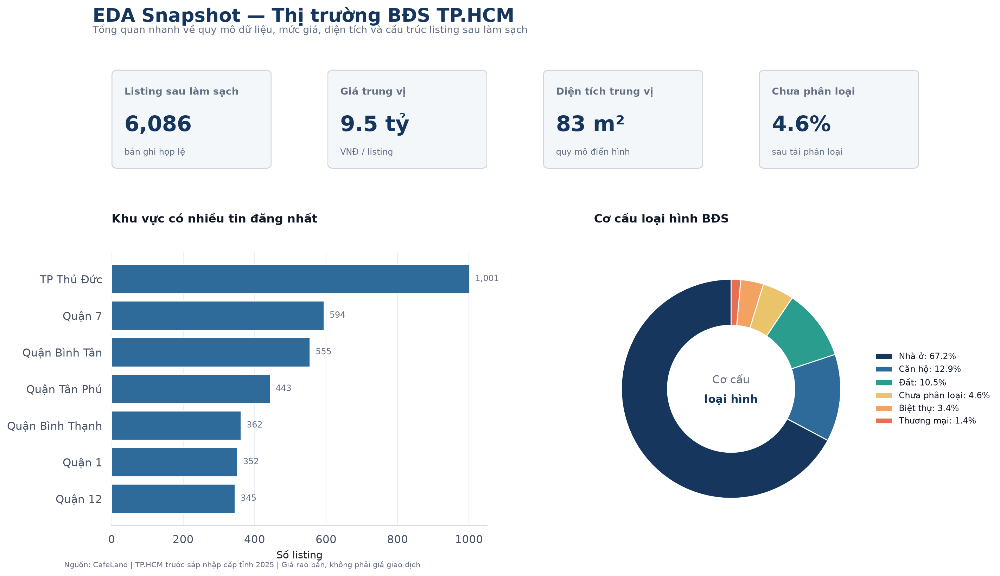

### price_distribution

- Output: `../reports/figures/01_price_distribution.png`
- Insight: Giá rao bán lệch phải: trung vị 9.50 tỷ VNĐ nhưng phân vị 95% 98.30 tỷ. Thang log giúp nhìn rõ phần lớn thị trường thay vì bị chi phối bởi vài listing rất đắt.

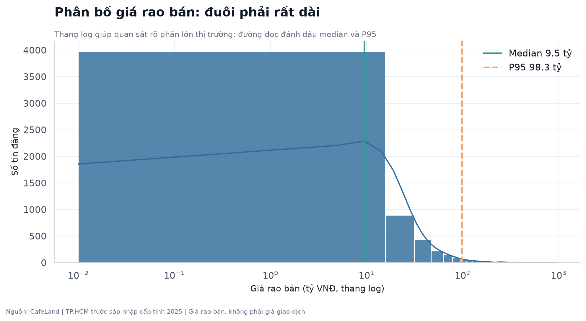

### area_distribution

- Output: `../reports/figures/02_area_distribution.png`
- Insight: Diện tích có trung vị 83.0 m² và phân vị 95% 542.2 m². Phân phối đuôi dài ủng hộ xử lý ngoại lai trên log-scale.

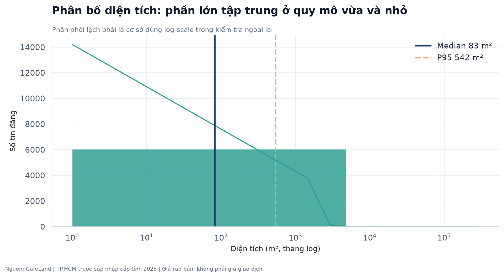

### property_type_distribution

- Output: `../reports/figures/03_property_type_distribution.png`
- Insight: house chiếm 67.2% dữ liệu cleaned; unknown còn 4.6%. Nhãn chưa chắc chắn được giữ unknown thay vì gán đoán.

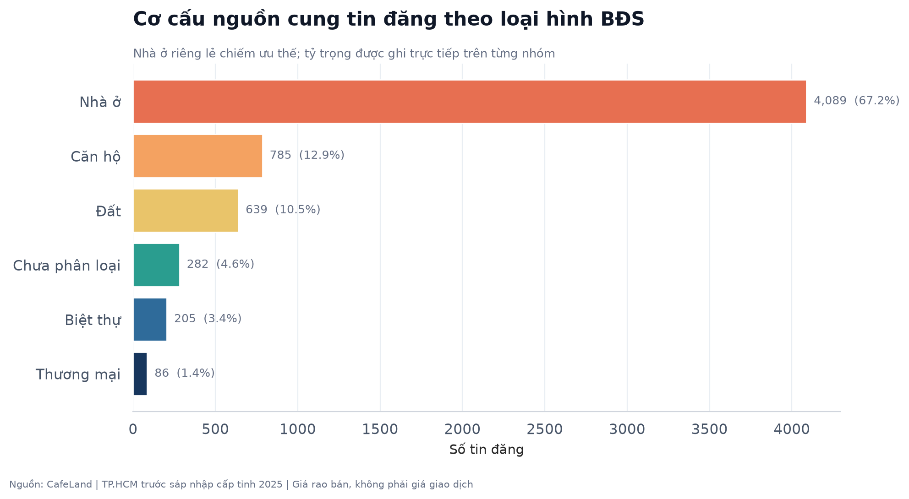

### price_m2_by_property_type

- Output: `../reports/figures/04_price_m2_by_property_type.png`
- Insight: Trong nhóm có ít nhất 30 tin, trung vị giá/m² từ 58.0 triệu (land) đến 173.9 triệu (villa). property_type vì vậy là feature có cơ sở EDA.

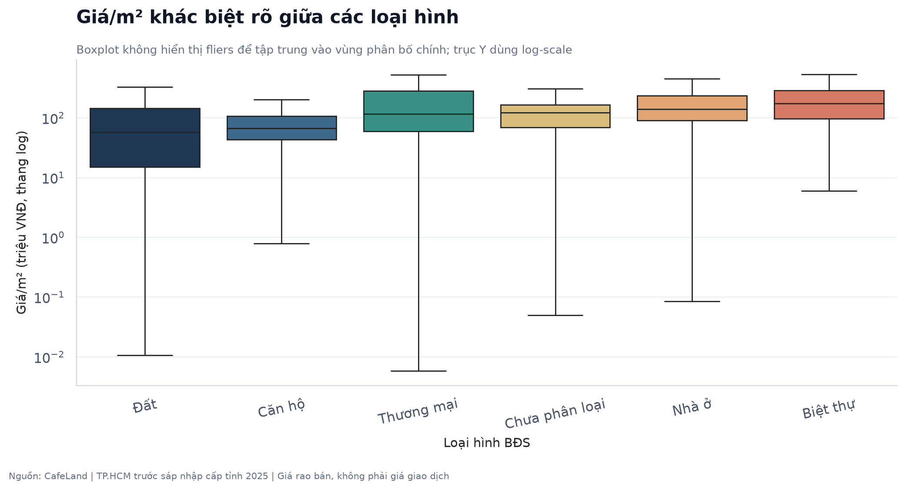

### price_m2_by_area

- Output: `../reports/figures/05_price_m2_by_area.png`
- Insight: Giá/m² phân hóa theo vị trí: Quận 1 đạt trung vị 445.6 triệu/m² so với 7.3 triệu/m² ở Huyện Củ Chi trong nhóm đủ mẫu. Chênh lệch này cho thấy legacy_area là đặc trưng quan trọng cần giữ cho BT4.

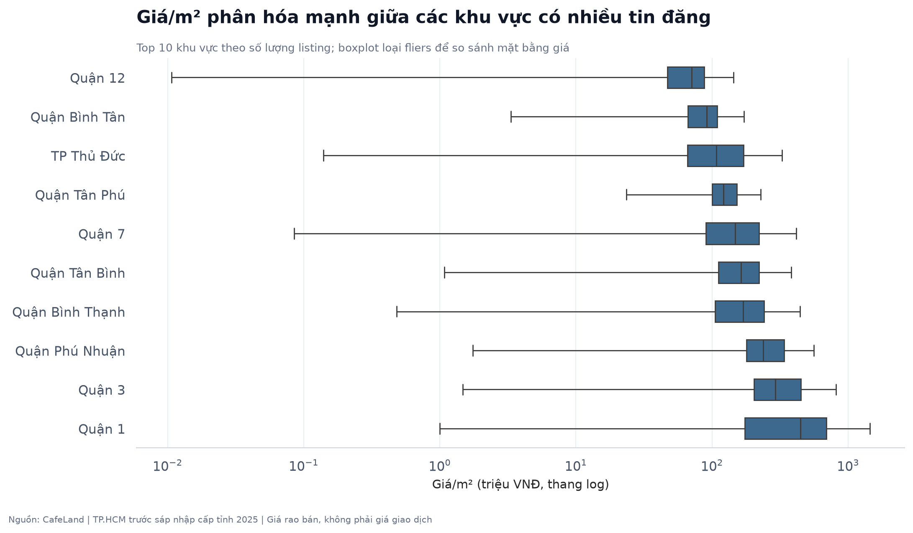

### price_vs_area

- Output: `../reports/figures/06_price_vs_area.png`
- Insight: Spearman(area, price) = 0.53. Quan hệ dương nhưng phân tán, nên model cần kết hợp vị trí và loại hình thay vì chỉ diện tích.

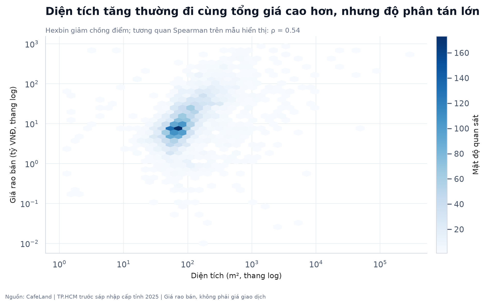

### listing_count_by_area

- Output: `../reports/figures/07_listing_count_by_area.png`
- Insight: TP Thủ Đức có 1,001 tin (16.4% cleaned). Mật độ mẫu không đều, vì vậy BT4 nên kiểm tra sai số theo khu vực.

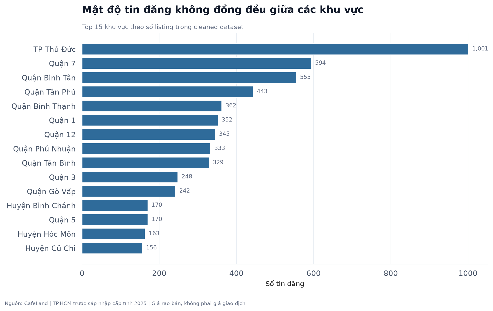

### median_price_m2_by_area

- Output: `../reports/figures/08_median_price_m2_by_area.png`
- Insight: Trong khu vực có ít nhất 30 tin, Quận 1 đứng cao nhất và Huyện Củ Chi thấp nhất về trung vị giá/m². price_per_m2 chỉ dùng EDA vì được suy ra từ target.

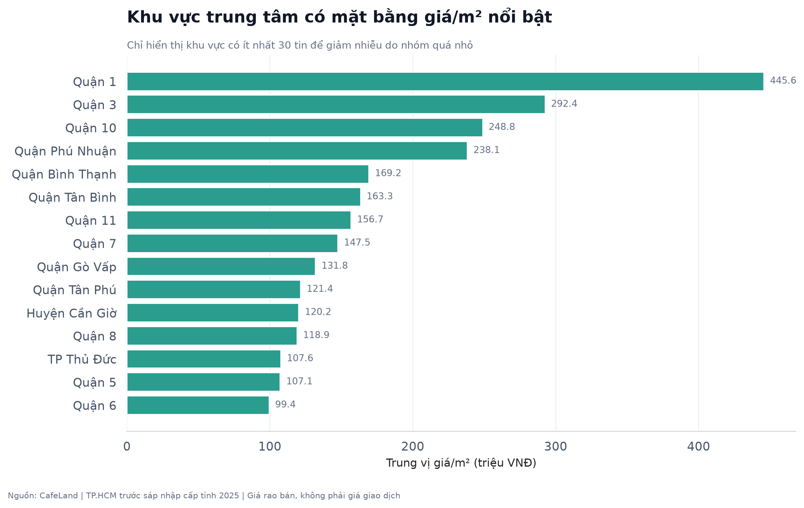

### correlation_heatmap

- Output: `../reports/figures/09_correlation_heatmap.png`
- Insight: Heatmap dùng Spearman do các biến lệch; area_m2 và price_vnd có hệ số 0.53. Các biến target-derived không đi vào model v1.

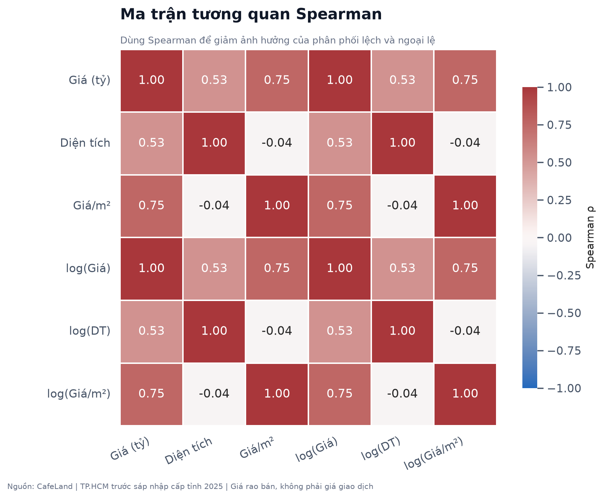

### cleaning_summary

- Output: `../reports/figures/10_cleaning_summary.png`
- Insight: Pipeline loại 304 URL không phải listing và 62 dòng có ít nhất hai phiếu ngoại lai robust. Quy tắc nhiều cờ giúp bảo thủ hơn so với xóa theo một ngưỡng duy nhất.

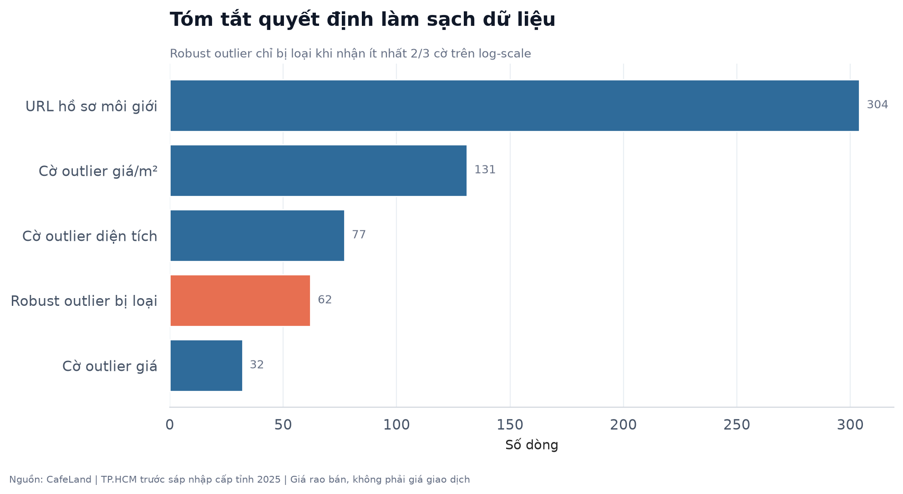

### missingness_profile

- Output: `../reports/figures/11_missingness_profile.png`
- Insight: Trường thiếu nhiều nhất là listing_date (100.0%). Các trường thiếu cao chủ yếu phản ánh giới hạn của card-only crawl, vì vậy không được impute máy móc; việc giữ missing giúp tránh tạo tín hiệu giả trước bước modeling.

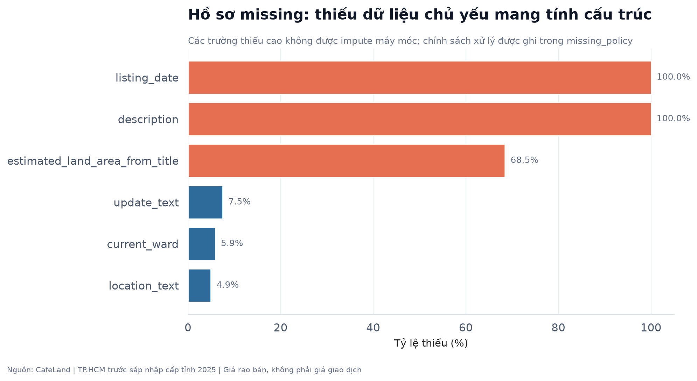

### market_positioning

- Output: `../reports/figures/12_market_positioning.png`
- Insight: Biểu đồ đặt quy mô nguồn cung cạnh mặt bằng giá/m² để nhận diện các khu vực có vai trò thị trường khác nhau. TP Thủ Đức nổi bật về số lượng tin, trong khi Quận 1 nổi bật về median giá/m²; điều này củng cố nhu cầu đưa yếu tố vị trí vào mô hình.

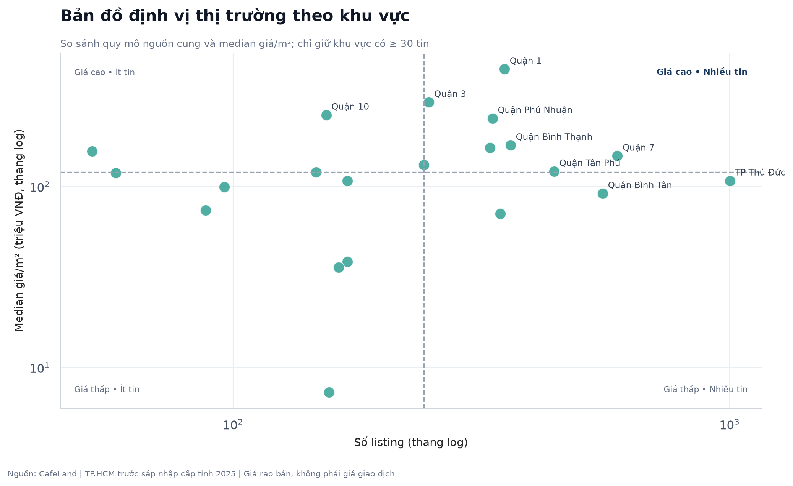

### interactive_treemap

- Output: `../reports/figures/13_market_treemap.html`
- Insight: Treemap tương tác kết hợp quy mô tin đăng với trung vị giá/m² theo khu vực → loại hình, phục vụ storytelling và drill-down. Người xem có thể nhận diện nhanh nơi vừa có nhiều tin vừa có mặt bằng giá cao.

[Mở biểu đồ Plotly tương tác](../reports/figures/13_market_treemap.html)

### interactive_price_area

- Output: `../reports/figures/14_price_area_interactive.html`
- Insight: Scatter Plotly cho phép hover từng listing và lọc trực quan theo loại hình; quan hệ diện tích–giá có Spearman khoảng 0.53 nhưng vẫn phân tán mạnh. Tính tương tác giúp kiểm tra các cụm và điểm bất thường tốt hơn biểu đồ tĩnh.

[Mở biểu đồ Plotly tương tác](../reports/figures/14_price_area_interactive.html)

## 5. Bảy insight chính

1. Sau kiểm soát chất lượng còn 6,086 listing; loại 304 URL hồ sơ môi giới và 62 ngoại lai mạnh.
2. Giá rao bán lệch phải: trung vị 9.50 tỷ VNĐ, phân vị 95% 98.30 tỷ. Phân tích log giúp hạn chế vài listing giá rất cao lấn át phần lớn thị trường.
3. Diện tích cũng có đuôi dài: trung vị 83.0 m², phân vị 95% 542.2 m². Vì vậy ngoại lai được đánh dấu trên log-scale thay vì cắt bằng một ngưỡng tuyệt đối.
4. house là loại hình lớn nhất (67.2%). Sau tái phân loại bằng title/URL, unknown còn 4.6%.
5. Trong khu vực có ít nhất 30 tin, Quận 1 có trung vị giá/m² cao nhất (445.6 triệu), còn Huyện Củ Chi thấp nhất (7.3 triệu). Đây là mô tả giá rao bán, không phải kết luận nhân quả.
6. Tương quan Spearman giữa diện tích và tổng giá là 0.53; diện tích có thông tin dự báo nhưng không đủ để giải thích toàn bộ giá.
7. 7.7% bản ghi cleaned mang cờ area_definition_risk. Bước modeling cần theo dõi riêng vì area_m2 ở nhà phố đôi khi có thể phản ánh diện tích sàn thay vì diện tích đất.

## 6. Kết nối sang Feature Engineering và BT4

- Giữ area_m2, log_area_m2, property_type, legacy_area.
- Theo dõi area_definition_risk khi đánh giá sai số.
- Không dùng title, description, listing_id, url hoặc biến suy ra từ target.
- Trường detail sparse chỉ đưa vào nếu availability đủ sau enrichment.
- BT4 phải fit mọi ngưỡng preprocessing học từ dữ liệu chỉ trên train; cleaned BT3 là analytical snapshot, không thay thế sklearn Pipeline.

## 7. Peer review

Biên bản peer review lưu tại docs/peer_review.md và phải ghi rõ điều chỉnh trước khi nộp.
